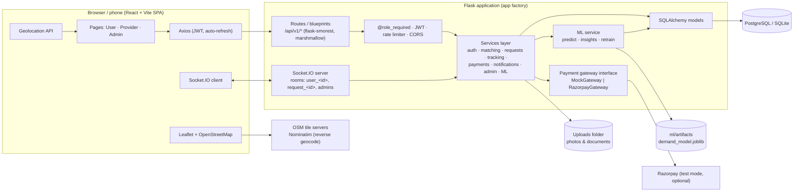
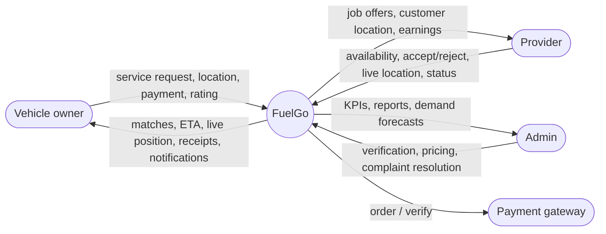
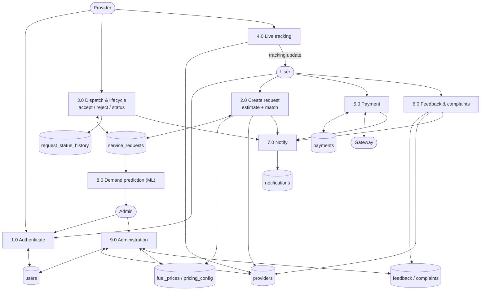

# FuelGo – System Architecture

FuelGo is a three-tier web application: a React single-page app, a Flask REST + Socket.IO API, and a relational database (PostgreSQL in production, SQLite for local development). A scikit-learn module trains on the service history to forecast fuel demand.

## 1. System architecture

**Layering rule:** routes only parse/validate input (marshmallow schemas) and call a service; services hold the business rules and talk to models; models own persistence and serialisation. Realtime pushes go through `services/realtime.py`, so services never touch Socket.IO directly.

## 2. Module map (matches the project synopsis)

| Synopsis module | Implementation |
|---|---|
| User registration & authentication | `services/auth_service.py`, `routes/auth.py`, JWT (access + refresh), bcrypt, rate-limited |
| Vehicle management | `services/vehicle_service.py`, `routes/vehicles.py` |
| Fuel delivery request | `request_service.create_request`, `pricing_service.estimate` |
| Mechanic assistance request | same lifecycle, category-based pricing, photo upload |
| GPS location & provider matching | `utils/geo.py` (Haversine, ETA, zones), `matching_service.find_candidates` |
| Booking & lifecycle | `request_service` (accept / reject → auto-reassign / status / cancel) |
| Live tracking | `tracking_service`, `sockets.py`, demo simulator |
| Digital payment | `payment_service`, `services/payments/gateways.py` |
| Ratings, feedback & complaints | `feedback_service` |
| Notifications | `notification_service` (DB + Socket.IO push) |
| Admin management | `admin_service`, `routes/admin.py` |
| Fuel demand prediction (ML) | `ml/dataset.py`, `ml/train.py`, `services/ml_service.py` |

## 3. Data flow diagram

### Level 0 (context)

### Level 1

## 4. Matching & ETA

1. Filter providers: matching `provider_type`, `is_verified`, `is_available`, account active, has a location, supports the requested fuel, **not already holding an active request**, within `min(service_radius_km, 25 km)`.
2. Distance = Haversine great-circle distance; ETA = distance × 1.3 road factor ÷ traffic speed (35/25/15 km/h for low/medium/high, by hour of day) + 3 min dispatch.
3. Score (lower is better) = 0.55·distance/25 + 0.30·(1 − rating/5) + 0.15·min(ETA, 90)/90. New providers get a neutral 4.0 rating prior.
4. If a provider rejects (or goes offline / gets suspended) the request is re-offered to the best remaining candidate, excluding everyone who declined; if none remain it becomes `REJECTED`.

## 5. Realtime

| Event (server → client) | Room | Payload |
|---|---|---|
| `notification` | `user_<id>` | notification row |
| `request:new` | provider's `user_<id>` | request |
| `request:update` | `request_<id>`, customer, provider, `admins` (deduplicated) | request |
| `tracking:update` | `request_<id>` | provider position, ETA, distance |

Clients send `request:join` / `request:leave` and providers send `provider:location`. When the socket is down the UI polls `GET /requests/<id>/tracking` every 5 s.

## 6. Security

- bcrypt (12 rounds) password hashing; JWT access (12 h) + refresh (14 d); blocked users are rejected on every request.
- `@role_required(...)` decorator on every protected endpoint; object-level checks in services (a user sees only their requests, a provider only assigned ones).
- Rate limiting on `/auth/*` (default `20 per minute`, configurable).
- Uploads: extension allow-list, 8 MB limit, random file names. Provider documents are served only to the owner and admins.
- Secrets only from environment (`.env`, never committed); production refuses to start without them.
