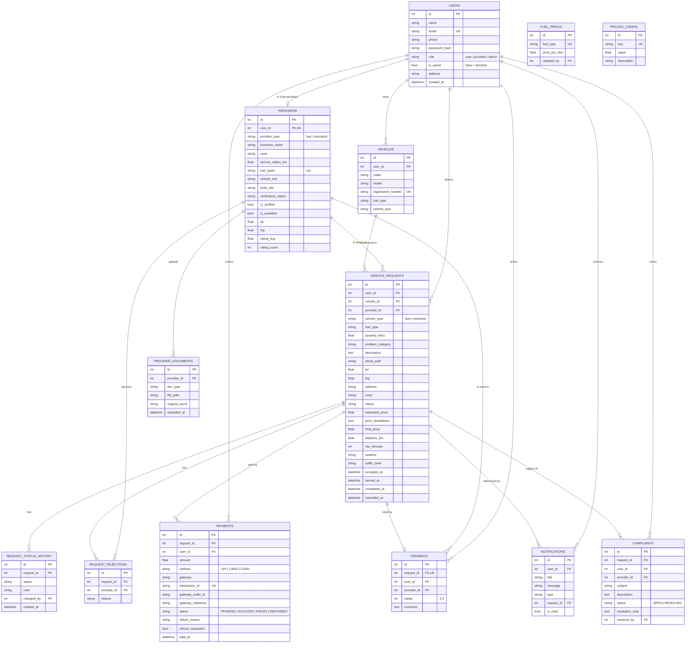

# FuelGo – ER Diagram

All tables have integer surrogate keys, foreign keys with `ON DELETE` rules, and `created_at` / `updated_at` timestamps where rows change. The schema is created by the Alembic migration in `backend/migrations/versions/`.

## Key indexes

| Table | Index | Purpose |
|---|---|---|
| providers | `(provider_type, is_verified, is_available)` | candidate filtering during matching |
| service_requests | `(status, created_at)` | admin monitor, dashboards |
| service_requests | `(user_id, status)` | active-request / double-booking check |
| service_requests | `provider_id`, `zone`, `service_type` | provider queue, ML insights |
| notifications | `user_id`, `is_read`, `created_at` | bell and unread count |
| payments | `transaction_id` (unique), `status` | receipts, admin filters |

Constraints: `users.role IN ('user','provider','admin')`, `feedback.rating BETWEEN 1 AND 5`, one feedback per request, one rejection per (request, provider).
