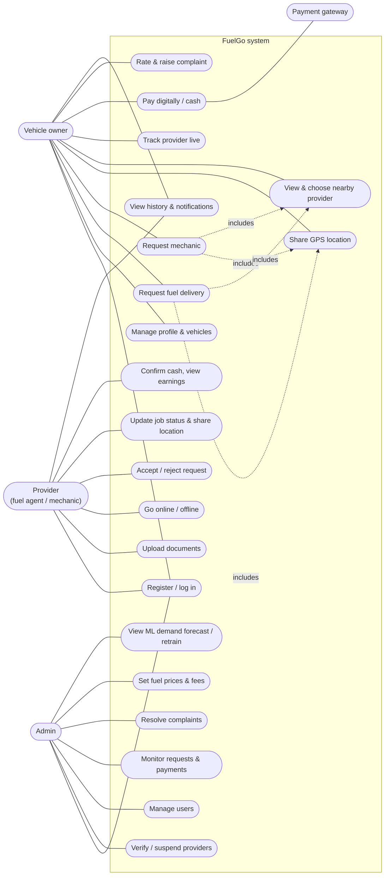
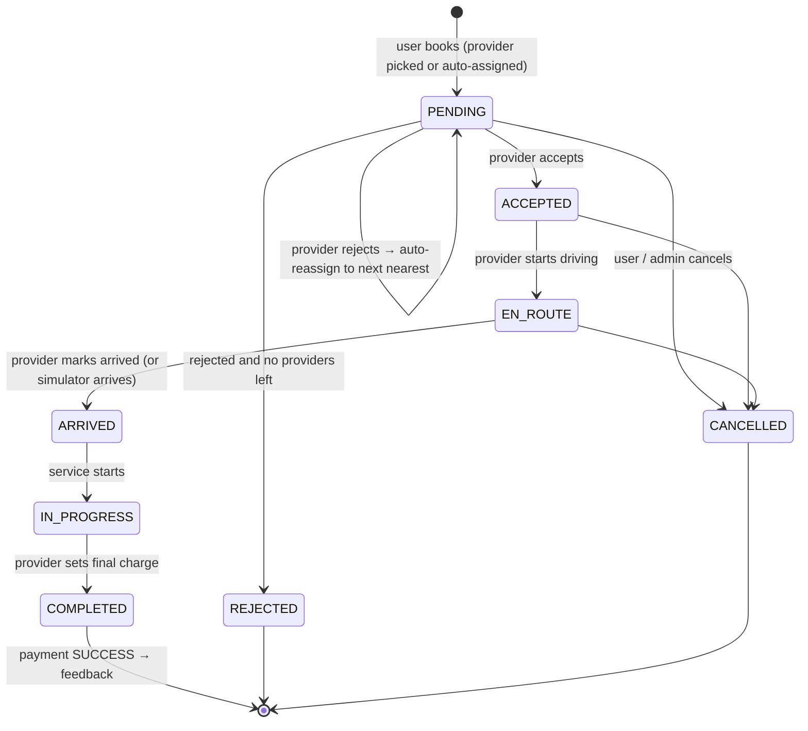
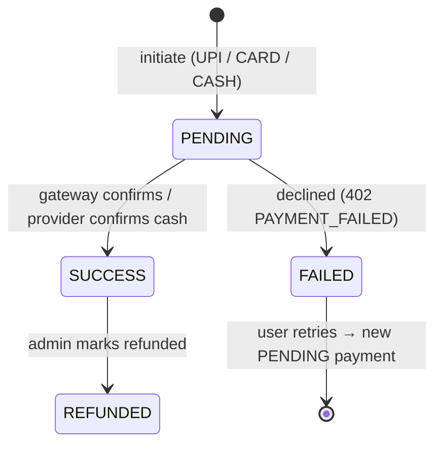
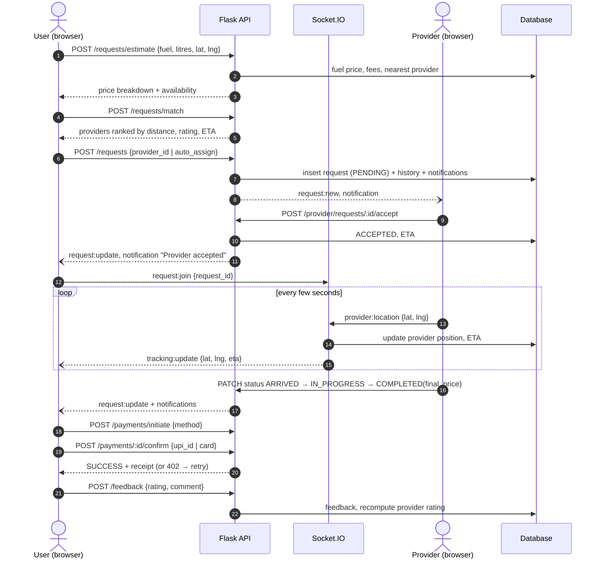
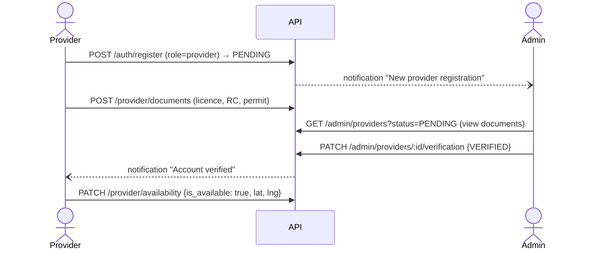

# FuelGo – Use Cases, Lifecycle and Flows

## 1. Use-case diagram

Mermaid has no native use-case diagram, so actors are drawn as nodes and use cases as rounded boxes inside the system boundary.

## 2. Request lifecycle (state diagram)

Rules enforced in `request_service`:

- Only forward transitions in `PROVIDER_FLOW` are allowed (`409 CONFLICT` with `allowed_next` otherwise).
- A user can hold one active request at a time; a provider can hold one active job and is not offered new requests while busy.
- Cancellation is allowed only in `PENDING`, `ACCEPTED`, `EN_ROUTE`.
- Payment opens only in `COMPLETED`; a request can be paid once.

## 3. Payment state

## 4. Main sequence: fuel request to rating

## 5. Provider onboarding

